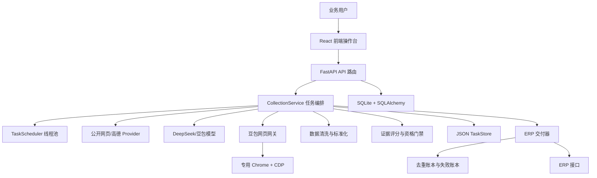

# 多城市 B 端客户线索采集与核验平台：零基础上手与实习工作详解

> 读者对象：第一次接触前后端项目、数据库、AI 接口或浏览器自动化的同学。
>
> 阅读目标：读完后能够回答五个问题：这个项目解决什么问题？用户怎么使用？代码从哪里开始运行？一条线索如何变成可交付数据？我在项目中具体做了什么？

---

## 目录

1. 先用一句话理解项目
2. 零基础必须认识的概念
3. 项目技术栈总览
4. 用户使用项目时会经历什么
5. 项目整体架构与目录地图
6. 如何在本地理解和运行项目
7. 前端页面怎么工作
8. 后端 API 和任务如何工作
9. 采集、核验、补全和去重的核心逻辑
10. 数据库、JSON、文件和数据保存边界
11. Playwright、CDP、固定 Profile 和豆包网页
12. ERP 推送、稳定 GUID 和内容指纹
13. 典型问题与排查思路
14. 我作为实习生完成的工作
15. 面试时如何介绍项目
16. 零基础读源码的推荐顺序
17. 从用户点击到最终交付：完整调用链
18. 项目内部的数据模型与状态机
19. 采集质量是怎样做出来的
20. 技术栈为什么这样选：逐项权衡
21. 典型问题的完整排查闭环
22. 测试、交付和代码评审怎么做
23. 作为实习生如何讲清楚自己的角色
24. 最终记忆卡片

---

# 一、先用一句话理解项目

这是一个帮助业务人员寻找 B 端客户线索的内部工具。用户输入城市、行业和联系方式要求，例如“找深圳和广州的住宅软装设计公司，希望有手机号或邮箱”，系统会从公开网页、地图数据和模型能力中发现候选公司，再对公司主体、联系方式和来源证据进行核验，最后把合格结果导出为文件，或者推送给 ERP 系统。

这里最容易产生的误解是：项目不是“问一次 AI，然后让 AI 编一批客户”。项目的核心价值恰恰在于不直接相信模型。模型、地图和网页搜索只能帮助发现候选；最终是否认为某条线索可用，取决于公司名称是否完整、联系方式是否真实、证据链接能否追溯、是否已经交付过等规则。

可以把项目想象成一个带质量检查的流水线：

```text
业务人员提出需求
  -> 系统寻找可能的公司
  -> 检查公司是不是目标城市、目标行业的真实主体
  -> 补全手机号、邮箱、联系人等信息
  -> 检查联系方式是否有公开证据
  -> 清洗和去重
  -> 导出或发送到 ERP
```

如果把“找到候选”比作在网上找名单，那么“核验、清洗、去重和交付”才是把名单变成业务可用数据的过程。

## 1.1 这个项目解决的业务问题

传统找 B 端客户通常依靠人工搜索、地图查店、整理表格、打电话验证。这个过程有几个典型问题：

- 城市多时，人工很难覆盖所有区域和关键词；
- 搜索结果中有排行榜、装修案例、招聘、培训机构、建材商等无关信息；
- 网页上出现手机号，不代表号码一定属于当前公司；
- 同一公司可能在多个平台重复出现，重复录入会浪费销售精力；
- 即使采集到了数据，也要考虑怎么让 ERP 接收、怎么知道哪些已经推送成功；
- 长时间任务会受到网络超时、模型错误、浏览器登录失效和第三方安全验证影响。

项目把这些问题拆开处理，而不是依赖一个“大模型提示词”全部解决。

## 1.2 什么是“线索”

在这个项目里，一条线索通常至少包含：

- 城市；
- 公司名称；
- 手机号、邮箱或微信等联系方式中的一种或多种；
- 地址和服务简介等辅助信息；
- 发现它的来源链接；
- 公司名称核验状态；
- 联系方式核验状态；
- ERP 是否已经推送。

“候选公司”和“有效线索”不是同一个概念。候选公司只是看起来可能符合要求的结果；有效线索必须满足项目设定的主体、联系方式和证据门槛。

---

# 二、零基础必须认识的概念

这一节不要求会写代码，只需要先建立一个正确的地图。

## 2.1 前端、后端和 API

**前端**是用户能看到和点击的网页。这个项目的前端负责显示输入框、城市选择、任务进度、线索表格、导出按钮和人工推送按钮。

**后端**是运行在服务器或本机后台的程序。它负责真正的采集、调用模型、保存数据、控制任务、连接 ERP。用户不直接看到后端代码，但前端每次点击按钮都会向后端发送请求。

**API** 可以理解为前端和后端之间约好的“办事窗口”。例如前端请求“创建任务”，后端收到后生成一个任务 ID；前端请求“读取线索”，后端返回当前任务的分页结果。项目的 API 路径以 `/api/v1` 开头。

## 2.2 什么是任务、线程和工作单元

一次“采集深圳软装公司”的操作不是瞬间完成的，所以系统把它保存成一个**任务**。任务有自己的 ID、状态、城市、关键词、进度、错误信息和线索结果。

**线程**可以理解为程序里独立执行的一条工作路线。网页请求不能一直卡住用户点击，因此后端把长时间采集任务放进线程池运行，HTTP 接口只负责快速告诉前端“任务已经开始”。

**工作单元**是任务的最小可恢复部分。通常是“一个城市 + 一个关键词 + 一个数据来源”。例如 5 个城市、3 个关键词和 1 个数据源，会形成 15 个发现工作单元。某一个单元失败时，只重试它，不必把前面成功的城市全部重跑。

## 2.3 什么是数据库、JSON 和文件存储

数据库是程序用来长期保存结构化数据的地方。项目使用 SQLite 作为轻量数据库，主要保存用户、工作空间、角色和凭据元数据等关系数据。

JSON 是一种文本数据格式，长得像字典或对象。例如：

```json
{
  "id": "任务编号",
  "status": "running",
  "cities": ["深圳", "广州"]
}
```

当前采集任务、线索、进度和检查点主要由 `TaskStore` 保存为 JSON 文件。这样单机 MVP 不需要额外安装数据库服务，也容易直接看到一个任务当前保存了什么状态。

## 2.4 什么是模型、Provider 和证据

**模型**指 DeepSeek、豆包等大语言模型。它们擅长理解自然语言、提取关键词、辅助判断行业相关性、从文本中整理结构化字段。

**Provider** 是外部数据来源适配器。高德地图、公开网页搜索、网页端豆包都可以看作不同 Provider 或数据通道。它们对外部网站的请求方式不同，但项目会把返回结果整理成统一的线索字段。

**证据**指可以回溯的公开信息，例如网页 URL、网页原文中同时出现的公司名和手机号。项目用证据来回答“为什么系统认为这条信息是真的”，而不是只保存一个模型置信度数字。

## 2.5 什么是 ERP

ERP 是企业资源计划系统。业务人员不希望线索只停留在一个网页表格里，通常希望合格数据进入公司已有的客户、销售或运营系统。项目的 ERP 交付模块负责把内部线索转换成对方接口要求的 JSON，并记录成功、失败和重试状态。

---

# 项目技术栈总览

“技术栈”不是一串为了显得专业的名词，而是一个项目为完成不同工作而选择的工具组合。可以把它理解成一间工厂的分工：前端负责让人操作，后端负责执行业务规则，数据库和文件负责保存状态，浏览器自动化负责操作网页，测试工具负责检查改动是否破坏原有功能。

本项目是一个**前后端分离的单机 MVP 线索采集与交付系统**。其中 MVP（Minimum Viable Product，最小可行产品）指先实现一条完整、可验证的业务闭环：从配置任务、发现和核验公司，到查看、导出、推送 ERP；不在第一阶段就引入分布式消息队列、云数据库集群等复杂基础设施。

## 一张表看懂技术分工

| 层次 | 主要技术 | 在项目中完成什么 | 解决的问题 |
|---|---|---|---|
| 前端界面 | React、React DOM、TypeScript | 操作台、表单、任务进度、线索表格和导出入口 | 让业务人员可视化地创建和管理任务 |
| 前端构建 | Vite、`@vitejs/plugin-react`、Node.js | 本地开发服务器、前端打包、开发期 API 代理 | 让前端开发、刷新和联调更快 |
| 后端接口 | Python、FastAPI、Uvicorn | `/api/v1` REST API、参数校验、任务创建和查询 | 前端有稳定的“办事窗口”调用业务能力 |
| 配置管理 | Pydantic Settings、`.env` | 端口、开关、外部服务地址等配置读取 | 把环境差异从代码里移走，减少硬编码 |
| 异步任务 | `ThreadPoolExecutor`、`Queue`、`Lock` | 长时间采集、任务调度、浏览器 actor 串行执行 | 避免一个 HTTP 请求卡住，也避免浏览器被并发抢占 |
| 关系数据 | SQLAlchemy、SQLite、Alembic | 用户、工作空间、角色、凭据元数据和审计等 | 用有结构、有关联的数据模型管理身份与权限 |
| 运行数据 | JSON `TaskStore` | 采集任务、线索、进度、检查点和 activity | 单机阶段易检查、易恢复的任务快照 |
| AI 与网络调用 | HTTPX、DeepSeek、豆包/Ark Responses、高德等 Provider | 关键词理解、候选发现、相关性判断和补全 | 把外部服务纳入统一的业务流程 |
| 浏览器自动化 | Playwright、Chrome CDP、固定 Profile | 连接已登录豆包网页、执行网页操作和重连 | 复用真实登录态，降低重复登录成本 |
| 文件与交付 | OpenPyXL、CSV/JSON/ZIP、UUID5、SHA-256 | 导出 XLSX、生成稳定客户标识和 ERP 防重指纹 | 方便业务使用，并保证交付可追溯、可幂等 |
| 安全 | pwdlib Argon2、PyJWT、Fernet、HttpOnly Cookie | 密码哈希、会话认证、敏感凭据加密 | 不把密码和密钥以明文形式保存或暴露给浏览器 |
| 质量保障 | pytest、pytest-asyncio、pytest-cov、Ruff、`tsc`、Vite build | 后端测试、异步测试、覆盖率、代码风格、类型与构建检查 | 在交付前尽早发现回归问题 |

下面按层次解释。零基础读者不需要一次记住所有包名，先记住每一层“负责什么”，再回到代码中找对应文件即可。

## 前端：React、TypeScript 与 Vite

### React 和 React DOM

React 是用于编写网页界面的 JavaScript 库。它的核心想法是：界面由“当前数据状态”推导出来。当任务状态从 `queued` 变成 `running`，或者线索列表更新时，前端不需要手工逐个改页面文字，只要更新状态，React 会重新渲染受影响的区域。

项目的主要前端页面集中在 `frontend/src/App.tsx`。它负责组织输入需求、创建任务、轮询任务状态、显示线索、导出和 ERP 推送等操作。`React DOM` 是把 React 组件真正挂到浏览器页面上的运行层。选择 React 的原因是它适合这种“表单 + 表格 + 多种任务状态”的操作台：交互多，但界面结构仍可以拆成清晰的组件和状态。

零基础注意点：React 不是后端，不直接访问数据库；它通常通过 `fetch` 调用 API。网页里看到的“正在采集”只是前端依据后端返回的状态所做的展示，真正的采集在后端线程中进行。

### TypeScript

TypeScript 是 JavaScript 的类型扩展。JavaScript 可以把任何值传来传去，灵活但容易在运行时发现拼写或字段错误；TypeScript 会在开发或构建阶段检查“这个对象应该有哪些字段、字段是什么类型”。

项目把任务、线索、分页结果等结构定义在 `frontend/src/types.ts`，把状态码对应的人类可读文案集中在 `frontend/src/labels.ts`，把请求封装放在 `frontend/src/api.ts`。例如后端返回的任务必须有 `id`、`status` 等字段，前端据此决定如何显示和轮询。选择 TypeScript，是为了让前后端的数据契约更明确，减少“接口字段改了但页面没同步”的低级错误。

### Vite、`@vitejs/plugin-react` 和 Node.js

Vite 是前端开发服务器和构建工具，`@vitejs/plugin-react` 是让 Vite 正确处理 React 组件和热更新的插件。Node.js 是运行前端开发工具的 JavaScript 运行环境，不等于浏览器本身。项目使用 Node.js 22，开发期通常由 Vite 在 5173 端口提供页面，并将 API 请求代理到后端。

选择 Vite 而不是配置一套复杂的打包器，是因为它启动快、开发时刷新快、React/TypeScript 支持成熟，很适合 MVP 阶段快速联调。`lucide-react` 则提供统一的常用图标，避免手写 SVG 并使按钮语义更直观。

## 后端：Python、FastAPI、Uvicorn 与配置

### Python

Python 是后端的主语言，版本约束为 3.12。它适合把 HTTP 调用、网页自动化、文件导出、数据清洗和业务规则写在一套代码中，也拥有成熟的异步和测试生态。项目后端依赖定义在 `backend/pyproject.toml`，业务入口从 `backend/app/main.py` 开始。

### FastAPI 和 Uvicorn

FastAPI 是 Web API 框架，负责把“访问某个 URL 并传入某些参数”映射到 Python 函数。例如 `backend/app/api/routes/collection_tasks.py` 提供创建任务、查询状态、读取线索和导出等路由；请求进入后，FastAPI 会根据模型检查参数格式，并把正确请求交给服务层。

Uvicorn 是 ASGI 服务器，负责真正监听端口、接收浏览器请求、调用 FastAPI 应用并返回响应。可以用一个简单比喻理解：FastAPI 是业务窗口的规章和办事人员，Uvicorn 是办公楼的门和接待系统。后端开发期通常监听 8010 端口。

选择 FastAPI 的原因是它和 Python 类型标注、Pydantic 数据模型配合紧密，API 文档和参数校验能力好，适合多接口、结构化输入输出的后台服务。它不等于“自动完成采集”，采集规则仍由服务层代码决定。

### Pydantic Settings 和 `.env`

Pydantic Settings 用于把环境配置读成带类型的 Python 对象。项目中 `backend/app/config.py` 集中定义配置，如服务端口、数据目录、外部 API 地址和功能开关；`SecretStr` 用于避免敏感值被随意打印到日志。

`.env` 是本地环境变量文件，适合放每台机器不同的配置。代码中只读取变量名，不把密钥写死在源码或文档中。这样开发、测试、演示环境可以使用不同配置而不改业务逻辑。零基础读者要特别注意：`.env`、Cookie、Token 不应提交到 Git，也不应复制进聊天记录。

## 长任务与并发：线程池、队列和锁

采集、模型调用和网页操作都可能需要几十秒甚至更久。若把它们直接放在“创建任务”的 HTTP 请求里，浏览器会一直等待，网络断开后用户也难以知道任务到底有没有继续。因此项目把任务创建和任务执行分开。

`scheduler.py` 使用 Python 标准库的 `ThreadPoolExecutor` 将任务提交到后台线程，并避免同一个任务被重复提交。`Queue` 用来按顺序投递需要浏览器处理的工作；`Lock` 用于保护多个线程都可能访问的共享状态。`doubao_browser.py` 把对浏览器的访问组织为 actor：一个专用线程按顺序处理浏览器命令，而不是让多个采集线程同时点击同一个页面。

这种设计解决了三件事：接口可以很快返回任务 ID；前端可以轮询进度；浏览器不会因为并发操作而页面串台。代价是单进程线程池适合单机 MVP，不天然等同于可无限扩展的分布式队列。未来多机器部署时，才会评估 Redis、Celery 或消息队列等方案。

## 数据与数据库：SQLAlchemy、SQLite、Alembic 与 JSON TaskStore

这是最容易被说混的部分。项目不是“所有数据都在 SQLite”，而是针对不同性质的数据采用不同保存方式。

**SQLite 是什么？** SQLite 是嵌入式关系型数据库。它不需要额外启动独立数据库服务，数据一般保存在一个本地数据库文件中；它支持表、主键、外键、查询和事务。它适合单机、轻量、部署成本低的场景，所以适合作为当前 MVP 的身份、工作空间、角色、凭据元数据和审计等关系型数据存储。

**SQLAlchemy 做什么？** SQLAlchemy 是 Python 的 ORM 和数据库访问工具。ORM（对象关系映射）让程序可以用 Python 类和对象描述表、字段、关系，再由框架生成或执行 SQL。它把业务代码与具体数据库访问细节隔开，也为以后由 SQLite 迁移到服务器数据库保留接口边界。

**Alembic 做什么？** Alembic 是 SQLAlchemy 常用的数据库迁移工具。数据库表结构会随着功能变化而演进，迁移文件记录“从旧表如何升级到新表”。这比让每个开发者手工改库更可追溯。项目中 ORM 的采集相关模型与 Alembic 迁移也存在，它们代表正式关系型存储的演进方向；但当前采集任务的实际运行快照仍以 JSON `TaskStore` 为主。

**JSON TaskStore 做什么？** `TaskStore` 将任务、线索、进度、检查点和 activity 保存到 `data/tasks/*.json`。这一层的目标不是替代关系数据库，而是以低运维成本保存“一个正在跑的任务现在到了哪一步”。单机调试时，开发人员能直接检查相应 JSON，任务中断后也能读取检查点继续判断恢复策略。

此外，`data/delivery/` 保存 ERP 的成功、失败和去重账本，`data/exports/` 保存导出的文件。把这些职责分开，能避免把临时运行状态、身份权限和交付记录混成一个难维护的表。

## AI 与外部服务：HTTPX、模型和 Provider

HTTPX 是 Python 的 HTTP 客户端库，用来调用外部 API 或网页服务。它负责发送请求、设置超时、读取响应；但它不决定“什么结果算有效”，业务判断仍在 `CollectionService`、规范化、证据和去重模块中完成。

项目可将 DeepSeek、豆包 API、Ark Responses 等模型用于需求理解、关键词扩展、候选公司发现、行业相关性判断和联系方式补全；高德及公开网页等 Provider 提供外部候选信息。对外部系统的共同风险是超时、限流、结果格式变化和服务暂不可用，所以代码会把外部调用封装在边界层，并在任务状态、错误信息和重试逻辑中呈现失败，而不是静默把任务标记为成功。

这一层为什么要保留多个 Provider：不同来源擅长的信息不同，且某一来源失效时不应让全部任务停摆。统一字段、规范化、证据评级和去重，是让多来源结果能合并使用的关键。

## 浏览器自动化：Playwright、CDP 与固定持久化 Profile

**Playwright 是什么？** Playwright 是浏览器自动化框架。它可以像用户一样打开页面、点击、输入、等待元素、读取页面内容和下载文件，但动作由代码控制。项目用它操作需要网页交互的豆包通道，而不是把浏览器自动化混入普通 HTTP 请求。

**CDP 端口是什么？** CDP（Chrome DevTools Protocol）是 Chrome 对外提供的调试通信协议。Chrome 以带有 `--remote-debugging-port=9333` 之类参数启动后，会在该端口监听调试连接；Playwright 可通过 CDP 附着到已经运行的浏览器，而不是每个任务都新建一个陌生浏览器。9333 是项目约定的本地 CDP 端口，不是公网接口，也不应暴露到不可信网络。

**什么是固定持久化 Profile？** Chrome Profile 是浏览器用户数据目录，里面会保存站点 Cookie、Local Storage、缓存及部分浏览器偏好。项目的 `dedicated_chrome.py` 使用固定的 `--user-data-dir` 启动专用 Chrome；同一个目录被持续复用，因此登录一次后的授权状态可以在重启后仍然存在。这就是“持久化”的本质：不是代码凭空保存了登录，而是浏览器把会话相关状态写入一个固定目录，下一次从同一目录读回。

`doubao_browser.py` 负责 Playwright actor、CDP 连接和重连、页面状态判断等。固定 Profile 的优点是减少人工反复登录，缺点是必须保护该目录的权限，且同一 Profile 不能被多个 Chrome 实例随意同时占用。若登录过期、出现验证码或站点页面改版，程序应报告可恢复错误并要求人工处理，不能绕过安全验证。

## 导出、ERP 交付与幂等：OpenPyXL、UUID5、SHA-256

OpenPyXL 是 Python 操作 Excel `.xlsx` 文件的库。项目使用它生成适合业务人员打开和筛选的 Excel，同时也支持 CSV、JSON 和 ZIP 等交付形式。CSV 适合简单表格和跨系统导入；JSON 更适合程序读取；ZIP 用于把多个文件打包。

ERP 推送由 `erp_delivery.py` 负责。它会把已经规范化、去重和评级后的内部线索转换成 ERP 要求的 JSON payload，记录业务返回码、成功失败和可重试状态。这里有两个重要概念：

- UUID5 用命名空间和稳定输入生成确定性的客户 GUID。同一业务对象在相同规则下会得到相同标识，便于不同批次关联。
- SHA-256 是一种哈希算法。项目可对 ERP payload 的规范化内容生成 fingerprint（指纹摘要），用来识别“这份内容以前是否已经成功推送过”。它不是加密后的原文，也不应用来保存密码。

这种“稳定 GUID + 交付账本 + payload 指纹”的组合实现了幂等性：用户因为网络问题重试一次操作时，系统尽量避免把同一条客户线索在 ERP 中创建两次。实际是否完全幂等，还要以 ERP 是否支持幂等键、业务码和最终回执为准。

## 安全：Argon2、JWT、Fernet 与 Cookie

安全模块的目的不是把系统变得难用，而是让身份和凭据不因一次日志、一次代码提交或一次前端脚本错误而泄露。

- `pwdlib[argon2]` 使用 Argon2 进行密码哈希。密码校验时是比较哈希结果，不应保存可还原的明文密码。
- PyJWT 用于签发和校验 JWT（JSON Web Token），让后端识别请求所代表的登录会话和身份。
- Fernet 用对称加密保存需要回读的敏感凭据。它与密码哈希不同：密码不需要恢复原文，应哈希；外部服务凭据有时需要在调用时取回，应加密。
- HttpOnly Cookie 将会话 Cookie 标记为不允许普通前端 JavaScript 直接读取，从而减少脚本注入后直接窃取会话的风险。它仍需要搭配 HTTPS、有效期、SameSite 等策略。

在实习答辩中，准确的表述是“项目实现了基础的密码哈希、会话认证和凭据加密边界”，不要笼统声称系统已经满足所有生产级安全或合规要求。

## 测试与工程质量：pytest、Ruff、类型检查和构建

后端使用 pytest 做单元和集成测试，`pytest-asyncio` 用于包含异步代码的测试，`pytest-cov` 用于统计覆盖率，freezegun 可在测试中固定时间，避免依赖真实时钟导致结果不稳定。Ruff 是 Python 的快速静态检查和格式/风格工具，可以发现未使用导入、明显语法问题和部分低级错误。

前端使用 TypeScript 的 `tsc` 做类型检查，用 Vite build 验证项目可以完成生产构建。它们都不能代替真实业务验证：类型正确不代表 ERP 一定能收单，构建通过也不代表浏览器登录态永远有效。因此项目还需要围绕任务状态、外部服务失败、去重和导出结果编写针对性的测试用例。

作为实习生，可以将这一段概括为：我没有只实现页面或接口，而是把“类型约束、任务状态、持久化、外部系统错误处理、回归测试和可交付文件”一起纳入闭环考虑。

---

# 三、用户使用项目时会经历什么

先从用户视角理解，再进入源码会更容易。

假设用户想做一个任务：“采集深圳和广州的住宅软装设计公司，要求有手机号或邮箱。”

1. 用户打开操作台，在前端填写需求、选择模型或数据源。
2. 用户点击创建，前端把文本和选项发给后端。
3. 后端检查参数是否合理，例如城市是否为空、模型是否配置、两个自动交付模式是否冲突。
4. 后端生成一个任务并保存，此时任务状态是 `draft`。
5. 用户点击开始，任务变为 `queued`，进入后台线程池。
6. 后台按城市和关键词查找候选公司，任务变为 `running`。
7. 系统先核验公司主体，再逐家公司补全联系方式。
8. 系统把清洗后的结果、证据、错误和进度不断保存。
9. 前端每隔一段时间轮询任务摘要，并在有变化时加载线索表格。
10. 用户可以暂停、继续、终止、导出，或者点击某一条结果进行人工 ERP 推送。

这套流程的关键在于：网页不会因为后台还在采集就失去响应；任务也不会因为浏览器刷新就消失。

---

# 四、项目整体架构与目录地图

## 4.1 架构图



图中最重要的中心是 `CollectionService`。它不是数据源本身，也不是前端页面，而是负责把“创建任务、调度、发现、核验、补全、去重和交付”连接起来的业务协调器。

## 4.2 目录地图

完整实现主要位于 `.worktrees/five-city-lead-platform` 工作树中。重要目录如下：

| 目录或文件 | 作用 | 初学者要先关注什么 |
|---|---|---|
| `backend/app/main.py` | FastAPI 启动入口 | 系统启动时创建了哪些组件 |
| `backend/app/config.py` | 环境配置 | 数据目录、端口、模型、浏览器和 ERP 开关 |
| `backend/app/api/routes/` | API 路由 | 前端按钮最终调用哪些后端函数 |
| `backend/app/collection/service.py` | 任务核心服务 | 一条任务从开始到结束如何被编排 |
| `backend/app/collection/` | 采集模块 | 数据源、模型、浏览器、清洗、证据、导出、ERP |
| `backend/app/models/` | ORM 数据模型 | 用户、工作空间和正式关系型数据结构 |
| `backend/tests/` | 后端测试 | 功能如何被验证 |
| `frontend/src/App.tsx` | React 主页面 | 用户交互、状态和表格如何组织 |
| `frontend/src/api.ts` | 前端请求封装 | 前端如何调用后端 API |
| `frontend/src/types.ts` | 前端类型 | 任务、线索、状态有哪些字段 |
| `frontend/src/labels.ts` | 文案与轮询辅助 | 为什么结果不会被频繁旧请求覆盖 |
| `data/` | 运行数据目录 | JSON 任务、导出、ERP 账本、浏览器节流状态 |
| `docs/` | 文档 | 规格、计划、日报和本教程 |

## 4.3 推荐先读哪些文件

零基础读源码不要从最长的 `service.py` 开始。推荐顺序是：

1. `backend/app/main.py`：看入口如何装配系统。
2. `frontend/src/App.tsx`：看用户能做哪些操作。
3. `frontend/src/api.ts`：把页面操作和 API URL 对起来。
4. `backend/app/api/routes/collection_tasks.py`：看每个 API 如何校验请求并交给 Service。
5. `backend/app/collection/service.py`：理解真正的业务流程。
6. `normalization.py`、`evidence.py`、`erp_delivery.py`：理解质量和交付规则。
7. `doubao_browser.py`：最后再看浏览器自动化，因为它涉及线程、队列和页面状态。

---

# 五、如何在本地理解和运行项目

## 5.1 运行环境

项目环境文件指定了 Python 3.12、Node.js 22 和 Playwright。实际运行记录使用 Conda 环境 `doubao-leads`。后端是 Python 项目，前端是 Node.js 项目，两者需要分别启动。

通常可以这样理解端口关系：

```text
浏览器访问前端：通常是 http://127.0.0.1:5173
前端请求后端：通过 Vite 代理转发到 http://127.0.0.1:8010
豆包专用浏览器：CDP 调试端口 http://127.0.0.1:9333
```

端口是进程之间通信的编号。5173 是用户网页入口，8010 是后端 API，9333 不是普通业务接口，而是 Chrome 给 Playwright 提供的调试连接入口。

## 5.2 启动前必须理解的配置

配置集中在 `backend/app/config.py` 和 `.env.example`。为了安全，真正的 `.env` 不应提交到 Git，也不应放到文档里。初学者应该知道配置的大类，而不是复制真实密钥：

- 应用环境与数据目录；
- SQLite 数据库地址；
- 高德或公开网页数据源配置；
- DeepSeek、豆包和 Ark 模型配置；
- 豆包网页是否启用、Profile 目录和 CDP 端口；
- ERP 是否自动推送、目标地址和超时；
- 最大并发任务数量。

如果配置缺失，系统应该明确告诉用户某个 Provider 或模型“未配置”，而不是悄悄生成假的数据。

## 5.3 前端和后端为什么要分开启动

前端负责开发体验和用户界面，Vite 会提供热更新；后端负责 API 和业务逻辑，FastAPI 运行在另一个进程。前端的 `vite.config.ts` 把 `/api` 代理到后端地址，这样浏览器看起来只访问前端站点，实际数据由后端返回。

分开的好处是：页面样式修改不需要重启采集服务；后端任务运行时也不会阻塞前端编译；以后可以把前端和后端部署到不同机器。

---

# 六、前端页面怎么工作

## 6.1 `App.tsx` 是什么

`frontend/src/App.tsx` 是当前 React 单页操作台的主组件。可以把它理解成一个“大控制面板”：它保存用户输入、当前任务、任务列表、当前城市、线索列表、模型选择、ERP 配置和豆包状态。

React 的核心思想是：数据状态变化后，页面自动根据新状态重新渲染。例如任务从 `running` 变成 `completed`，页面不需要手工修改每一行文字，只要状态更新，按钮、进度和标签会根据状态显示不同内容。

## 6.2 `api.ts` 为什么单独存在

`api.ts` 是前端访问后端的统一入口。它把 `fetch`、URL、HTTP method、JSON 序列化和错误处理集中起来。例如：

```text
api.createNaturalLanguageTask(...) -> POST /api/v1/collection-tasks/from-natural-language
api.startTask(taskId)              -> POST /api/v1/collection-tasks/{id}/start
api.leads(taskId, city)            -> GET  /api/v1/collection-tasks/{id}/leads
```

这样做的好处是页面组件不需要知道所有 URL 细节。若后端接口调整，优先修改 `api.ts`，而不是在几十个按钮回调中寻找字符串。

## 6.3 为什么前端需要轮询

采集任务可能运行几分钟甚至更久。用户点击“开始”后，后端不会一直占着 HTTP 请求等到任务完成，而是立刻返回任务摘要。前端随后每隔一段时间请求一次摘要，得到进度、状态、错误数和线索数量。

项目采用“摘要轮询 + 线索分页”的设计：

- 任务摘要不包含全部线索和 activity，响应很小，适合频繁轮询；
- 线索使用单独分页接口读取，避免一次把几百条结果塞进每次轮询；
- 当前任务或城市变化时，前端取消旧请求，避免旧城市的慢响应覆盖新城市结果。

`labels.ts` 中的 `createSequentialPoller` 会等本次请求结束后再安排下一次，避免网络慢时堆积十几个同时发送的轮询请求。

## 6.4 `types.ts` 的价值

TypeScript 允许为数据写类型。例如任务状态只能是 `draft`、`queued`、`running`、`paused` 等有限值；交付状态只能是 `display_only`、`pending`、`sending`、`succeeded`、`failed`。

这能在编译阶段发现很多错误。例如后端返回字段叫 `delivery_status`，前端若误写成 `deliveryState`，TypeScript 会提示问题。对于长期维护项目，类型不是装饰，而是接口契约的一部分。

---

# 七、后端 API 和任务如何工作

## 7.1 从 `main.py` 开始

`backend/app/main.py` 的 `create_app()` 是后端入口。它做的事可以概括为“把零件装成一台机器”：

1. 读取配置 `Settings`。
2. 创建 SQLAlchemy 数据库引擎和 Session 工厂。
3. 创建 JSON 任务存储 `TaskStore`。
4. 创建数据源 Provider 和模型核验器。
5. 创建 ERP 交付器。
6. 如果开启豆包网页，创建专用 Chrome 启动器和 Playwright 网关。
7. 把它们注入 `CollectionService`。
8. 注册认证、工作空间和采集任务路由。

这种写法叫依赖注入：Service 不自己到处创建浏览器、HTTP 客户端或数据库，而是在启动时拿到已经准备好的对象。测试时也可以换成假的 Provider，避免访问真实网络。

## 7.2 API 路由负责什么

`backend/app/api/routes/collection_tasks.py` 不直接执行采集。它主要做三类工作：

1. 校验请求，例如城市、关键词、Provider、模型和自动交付开关是否合法；
2. 检查当前用户是否有权限访问该任务；
3. 调用 `CollectionService`，并把异常转换成合适的 HTTP 响应。

例如创建自然语言任务时，路由会先让已选择模型尝试补充关键词，再调用 `parse_collection_intent` 解析城市、联系方式和数量，最后把结构化结果交给 `CollectionService.create_task`。

## 7.3 任务状态机

任务状态不只是“运行中/已完成”。项目使用更细的状态，原因是长任务需要可控和可恢复：

| 状态 | 日常语言解释 |
|---|---|
| `draft` | 已创建，但没有开始 |
| `queued` | 已经接受，等待线程池安排 |
| `running` | 正在采集、核验或交付 |
| `pausing` | 用户点了暂停，正在等当前外部请求结束 |
| `paused` | 已安全暂停，可以继续 |
| `waiting_for_login` | 豆包网页需要用户人工登录或完成验证 |
| `terminating` | 用户点了终止，正在收尾当前工作 |
| `terminated` | 不再继续，但已保存已有结果 |
| `completed` | 全部主要工作完成 |
| `completed_with_errors` | 主流程结束，但某些单元或交付失败 |

Python 线程不适合被外部强行杀死。项目采用“协作式停止”：用户点击暂停或终止后，系统写入请求标记；外部网络请求返回后，检查点发现标记并安全退出。这样可以避免正在写 JSON 或正在请求 ERP 时被粗暴中断。

## 7.4 `TaskScheduler` 做了什么

`scheduler.py` 使用 `ThreadPoolExecutor` 运行后台任务，并维护已提交任务集合。它解决两个实际问题：

- 用户连续点击开始，不会让同一个任务同时运行两次；
- 任务正在运行时又收到“恢复/重试”请求，可以记录为结束后重新提交，而不是直接并发执行。

这很重要，因为同一个任务若有两个线程同时写线索、调用模型和推送 ERP，会造成重复数据和状态错乱。

---

# 八、采集、核验、补全和去重的核心逻辑

## 8.1 `CollectionService` 是项目的核心

`backend/app/collection/service.py` 是最关键的业务文件。它管理任务创建、状态变化、数据发现、公司核验、联系方式补全、模型核验、ERP 交付和错误恢复。

可以把它理解成项目的“调度总台”。前端只告诉它“创建/开始/暂停/继续”，外部 Provider 只负责返回数据，最终由 Service 决定下一步调用谁、保存什么、是否允许交付。

## 8.2 第一阶段：发现候选公司

系统按城市、关键词和 Provider 生成工作单元。例如“深圳 + 软装设计 + 公开网页搜索”。Provider 返回候选结果后，Service 保存公司名、城市、匹配关键词、来源链接、地址和摘要等信息。

此时结果只是候选，可能仍然有错误：公司名可能是文章标题，业务可能不相关，手机号可能来自聚合平台，或者同一公司出现多次。

## 8.3 第二阶段：核验公司主体

系统会对公司名进行公开网页核验，主要检查：

- 公司名称是否足够完整，像真实企业或工作室名称；
- 页面是否指向目标城市；
- 页面是否与用户需求的行业相关；
- 是否有可保存的来源 URL 和说明。

结果写入 `company_name_verification_status`、`company_name_evidence_urls`、`company_name_verification_reason` 等字段。没有通过主体核验的候选可能保留在表格中供查看，但不会进入严格自动交付。

## 8.4 第三阶段：逐家公司补全联系方式

对于主体已通过的候选，系统逐家查询联系人、职务、手机号、邮箱、微信、地址和服务简介。这里可以使用模型 API，也可以使用已登录的豆包网页。

每家公司都有 `enrichment_state`：

- `pending`：尚未处理；
- `completed`：补全完成；
- `failed`：本次外部调用失败，后续可重试；
- `blocked`：公司主体未通过，不能补全。

逐家公司保存的好处是断点恢复。例如任务处理到第 37 家时浏览器断线，前 36 家已经保存，恢复后不需要重新请求它们。

## 8.5 为什么要标准化手机号和邮箱

用户从网页复制到的手机号可能是 `+86 138-0013-8000`、`138 0013 8000` 或带括号格式。`normalize_mobile` 会删除非数字字符，处理 `86` 前缀，最后只接受符合 `1[3-9]\d{9}` 的大陆手机号。

这意味着座机、短号、错误位数和普通文本不会被统计为手机号。项目曾遇到“邮箱或微信被算进有手机号数量”的统计问题，因此把“有联系方式”和“有有效手机号”拆成不同口径。

邮箱也不只是小写化。系统会过滤 `example.com`、`localhost` 等占位地址，并结合公司名、来源域名和证据文本，对多个邮箱排序，优先保留更可信的地址。

## 8.6 服务简介为什么要清洗

搜索摘要常混入“更新时间、电话、地址、驾车导航、查看地图”等内容。直接把这些文本送入 ERP，会导致 CRM 中出现一堆无意义的导航说明。

`clean_service_intro` 只保留软装、全案、室内、设计、整装、别墅等业务相关片段，并过滤日期、地址、电话、联系方式和导航词。这是看似小但很实用的数据质量工作。

## 8.7 证据分级如何避免模型幻觉

`evidence.py` 将联系方式证据分为 A、B、C 和 rejected：

- A：官网或权威页面能直接证明公司和联系方式；
- B：公司正向检索和手机号反向检索形成跨来源闭环；
- C：只有较弱公开信息，只能作为展示或人工复核依据；
- rejected：号码无效，或证据指向冲突公司。

只有 A/B 才能自动有效。模型返回的手机号即使格式正确，如果没有主体匹配的公开证据，也不会因为“看起来合理”就进入 ERP。

## 8.8 去重分为几层

项目并非只按公司名去重，而是同时考虑：

1. 同一任务中城市 + 公司名是否重复；
2. 同一任务中手机号、邮箱、微信是否重复；
3. 跨任务是否已经向 ERP 推送过同一城市公司的同类内容；
4. 同一手机号或邮箱是否已被归属到其他公司。

发生冲突时，项目优先保留证据分数更高、联系方式更完整、来源更可靠的记录，并尽可能合并可补充字段。

---

# 九、数据库、JSON、文件和数据保存边界

## 9.1 SQLite 是什么，为什么用它

SQLite 是一个文件型关系数据库。它不需要单独启动一个数据库服务器，数据通常保存在一个文件中，但仍支持表、索引、事务、唯一约束和 SQL 查询。

项目默认数据库连接是 `sqlite:///./data/identity.db`。选择 SQLite 的原因是项目首先要跑通单机 MVP：部署简单、没有 Docker/PostgreSQL/Redis 等额外运维负担，适合先验证真实采集和 ERP 交付流程。

## 9.2 SQLAlchemy 在项目中做什么

SQLAlchemy 是 Python 的 ORM 工具。ORM 可以理解为“用 Python 类操作数据库表”。例如 `User`、`Workspace`、`WorkspaceMembership`、`ProviderCredential` 和 `AuditLog` 都定义了数据库模型。

它的好处是：业务代码不需要到处拼接 SQL；模型可以定义唯一约束和关系；未来若迁移到 PostgreSQL，业务层不需要全部重写。

## 9.3 当前真实存储边界

这是项目中必须讲清的一点：

| 数据类别 | 当前主要存储 | 说明 |
|---|---|---|
| 用户、工作空间、权限、凭据元数据 | SQLite + SQLAlchemy | 结构化关系数据 |
| 采集任务、线索、进度、activity | JSON `TaskStore` | 当前运行主链路 |
| 导出结果 | `data/exports/` | XLSX、CSV、JSON、ZIP 文件 |
| ERP 成功/失败和去重 | `data/delivery/` | 成功账本、失败账本、去重账本 |
| 豆包查询节奏 | `data/doubao-web-pacing.json` | 重启后保留冷却状态 |
| 浏览器登录状态 | 固定 Chrome Profile 目录 | Cookie、站点数据等 |

项目中已经有 `CollectionTask`、`CollectionLead`、城市进度和 activity 的 SQLAlchemy 模型，也有 Alembic migration。这说明关系型采集存储方案已经设计和预留；但当前实际采集运行主链路使用 JSON TaskStore。面试时不能把这两件事说成“所有线索已经在 PostgreSQL”。

## 9.4 为什么 JSON TaskStore 仍然合理

对单机长任务来说，一个任务 JSON 快照有直观优势：任务状态、当前城市、已完成工作单元、线索、错误和 activity 可以一起保存；服务重启后读回文件即可恢复。

`TaskStore` 保存时先写临时文件，再原子替换正式文件。这样即使进程意外中断，也尽量避免把一半内容写进正式 JSON 文件。它还支持只更新部分 leads、分页读取、分批迭代导出等操作。

当未来需要多机部署、多个 worker 同时写大量任务、复杂查询和报表时，再把采集运行态迁移到 PostgreSQL 会更合适。

---

# 十、Playwright、CDP、固定 Profile 和豆包网页

## 10.1 为什么还需要浏览器自动化

有些能力不能稳定地通过后端 API 完成，例如需要用户登录的豆包聊天网页。此时项目使用 Playwright 操作真实 Chromium 浏览器页面：输入提示词、读取最新回复、检测页面是否在生成、检测是否出现登录或安全验证。

Playwright 是浏览器自动化库。它不是模型，也不是保存登录状态的工具；它的职责是让程序像用户一样操作网页。

## 10.2 CDP 端口是什么

CDP 是 Chrome DevTools Protocol。Chrome 可以打开一个本机调试端口，外部程序通过这个端口连接正在运行的浏览器。项目使用 `127.0.0.1:9333`。

可以把 CDP 理解为“浏览器给自动化程序开的连接门”。Playwright 通过 `connect_over_cdp` 连接已有的 Chrome，而不必每次启动临时浏览器。

CDP 端口不保存登录状态。保存登录状态的是浏览器 Profile。

## 10.3 固定持久化 Profile 是什么

启动专用 Chrome 时会传入固定 `--user-data-dir`，目录通常是 `data/doubao-browser-profile`。Chrome 会把 Cookie、LocalStorage、IndexedDB 等站点数据保存到这个目录。

流程是：

1. 专用 Chrome 使用固定目录启动；
2. 用户第一次在真实豆包页面人工登录；
3. Chrome 把登录会话写入固定 Profile；
4. 后端或浏览器重启后继续使用这个目录；
5. 页面尝试恢复已有登录状态。

这只能提高会话复用能力，不能保证永远不用登录。Cookie 过期、主动退出、第三方风险控制仍可能要求人工操作。

## 10.4 为什么要有专用 Chrome

日常浏览器可能被用户关闭、占用已有 Profile、安装插件或同时打开大量标签页。项目专门启动一个浏览器实例，固定 CDP 端口和 Profile，避免用户日常浏览行为影响采集会话。

`dedicated_chrome.py` 在启动前会检查 CDP 端口是否被其他浏览器占用，并检查 `/json/list` 是否出现真实页面目标。某些机器上 Chromium GPU 子进程会崩溃，因此启动参数还使用软件渲染相关兼容配置，降低“端口存在但页面不可用”的风险。

## 10.5 为什么浏览器操作要放进 actor 线程

同一个 Playwright page 不适合被多个线程同时操作。假设两个任务同时向豆包输入提示词，回复可能交叉，无法判断哪条回答属于哪家公司。

项目的做法是：业务线程把命令放进队列，单独的 actor 线程串行操作浏览器页面，最后通过 Future 把结果返回。

```text
采集任务线程 -> 命令队列 -> 豆包 actor 线程 -> Playwright 页面
                                          -> 返回查询结果
```

这保证同一时间只有一个提示词在当前页面执行。

## 10.6 节流、租约和人工验证

项目不会通过破解验证码或伪造浏览器行为绕过安全验证。它采取的是保守策略：

- 每次提示词随机间隔；
- 每批请求后进行较长冷却；
- 节流状态写入 JSON，重启不会清零；
- 同一豆包账号只允许一个网页任务持有租约；
- 发现登录或安全验证时任务进入 `waiting_for_login`；
- 用户人工完成后，监视器只读检查页面状态，连续多次 `ready` 后自动恢复任务。

这里的“租约”相当于占用权。等待人工验证期间也不释放租约，否则第二个任务可能抢占同一个聊天页面，导致会话混乱。

---

# 十一、ERP 推送、稳定 GUID 和内容指纹

## 11.1 ERP payload 是什么

ERP 不理解项目内部的全部字段，它需要自己的 JSON 格式。`build_erp_payload` 会把公司名、城市、服务简介、需求、手机号、邮箱、微信和来源信息映射为 ERP 约定字段。

发送前还可以带 Bearer Token，但 Token 只在后端传递，不应写入前端状态或文档。

## 11.2 为什么 HTTP 200 不等于推送成功

HTTP 200 只说明服务器收到了请求并正常返回。ERP 业务本身仍可能拒绝这条数据，例如字段不合法、账号无权限或业务规则不通过。

因此代码会继续检查返回 JSON 的业务字段。只有 `errCode == 0` 才被视为业务成功。失败时会记录 `last_error`、尝试次数和 payload 指纹，供后续重试。

## 11.3 什么是稳定客户 GUID

同一城市的同一公司需要一个稳定身份。项目用“城市 + 规范化公司名”通过 UUID5 生成 `customerAccountGuid`。同样的输入会得到同样的 GUID，因此系统能识别这是同一个业务客户。

## 11.4 什么是 fingerprint

ERP fingerprint 是对一份稳定 payload 做排序 JSON 序列化后，再计算 SHA-256 得到的内容摘要。可以理解为“这份交付内容的指纹”。

动态采集时间不参与 fingerprint，否则同一家公司每次运行因时间不同都会得到新指纹，去重就没有意义。若公司、联系方式和业务字段没有变化，fingerprint 一般保持不变；如果手机号或邮箱更新，fingerprint 会变化，系统可以判断是否需要更新交付。

注意：ERP fingerprint 不是浏览器指纹。项目没有生成或伪造 Canvas、字体、鼠标轨迹等反检测浏览器指纹。

## 11.5 交付状态如何避免重复

单条线索会经历：

```text
display_only -> pending -> sending -> succeeded / failed
```

发送前先写 `sending`，避免同一条数据被自动任务和人工按钮同时发送。成功后写成功账本和去重账本；失败后写失败账本，允许后续重试。去重账本同时按城市+公司、手机号和邮箱维护索引，解决跨任务、跨日期重复交付的问题。

---

# 十二、典型问题与排查思路

## 12.1 前端显示 0 条，后端明明有数据

排查不能只看页面。正确顺序是：

1. 看浏览器网络请求是否发到了正确任务和城市；
2. 看 `/leads` 接口返回的 `items` 和 `total`；
3. 看前端是否因为任务或城市切换取消了旧请求；
4. 检查 React effect 的依赖是否只包含会影响结果的字段；
5. 检查是否把每次都会变化的 `updated_at` 放进刷新条件，导致请求不断被取消。

项目通过摘要轮询、分页读取、串行 poller 和 `leadResultRefreshKey` 修复了这类问题。

## 12.2 任务暂停后为什么仍可能短暂运行

暂停不是立即杀死线程。假如线程正在等待外部模型或网页请求返回，系统只能在请求完成后检查暂停标记。因此任务会先进入 `pausing`，在下一个检查点转为 `paused`。

解决原则不是强制中断，而是外部调用前后都检查控制状态，所有已完成结果立即保存。

## 12.3 服务重启为什么不会全部重跑

每个城市、关键词、Provider 工作单元和每家公司补全后都保存检查点。任务文件中记录已完成单元、候选、线索、错误和当前进度。后端重启时会寻找未完成状态，并把没有活跃 future 的任务重新提交。

这并不意味着永远不会重复请求外部系统，而是尽量把恢复范围缩小到尚未确认完成的工作单元，并通过去重和交付 fingerprint 降低重复结果和重复推送风险。

## 12.4 手机号看起来正确，为什么不能交付

电话号码格式正确只证明它像手机号，不证明它属于当前公司。项目要求公司主体和联系方式在可追溯来源中匹配，或者存在跨来源的正反向验证。没有证据时，线索可以保留给人工查看，但严格自动交付会拒绝它。

## 12.5 豆包网页为什么需要人工处理验证

登录、验证码和安全验证属于第三方平台的安全边界。项目只能检测页面状态、降低请求频率、保存任务检查点，并在人工处理后恢复；不应该尝试破解、绕过或伪造验证行为。

---

# 十三、我作为实习生完成的工作

## 13.1 需求分析和方案拆解

我没有把需求理解成“批量调用 AI 找公司”，而是拆成候选发现、公司主体核验、联系方式补全、公开证据核验、数据清洗、去重和 ERP 交付。这个拆分决定了后续代码的模块边界，也让业务人员能区分“候选数量”和“严格有效数量”。

## 13.2 全栈功能开发

前端方面，我参与了任务创建、自然语言输入、状态展示、进度轮询、结果分页、导出、豆包网页状态和单条人工推送等功能。

后端方面，我参与了 FastAPI 路由、Pydantic 请求校验、任务状态机、线程池调度、任务检查点、错误重试和接口异常转换。

## 13.3 AI 与真实数据源集成

我接入和适配了公开网页、高德、DeepSeek、豆包 API、Ark Responses 和豆包聊天网页等不同通道。不同通道统一输出候选公司、联系方式、来源链接和核验信息，但模型只能参与发现和判断，不能替代公开证据。

## 13.4 数据质量和反幻觉控制

我实现或完善了手机号、邮箱、微信、公司名和服务简介的清洗规则；建立了公司主体与联系方式分离的证据门禁；增加了 A/B/C 证据分级；处理了“邮箱被算成手机号”“导航文字污染服务简介”“模型输出号码属于其他公司”等问题。

## 13.5 浏览器自动化和运行保障

我处理了固定 Chrome Profile、CDP 端口、页面引用失效、后端重启重连、GPU 兼容、请求节流、单账号租约和人工安全验证恢复等问题。这部分不仅是调用 Playwright，更是让真实网页登录态在长任务中稳定运行。

## 13.6 ERP 集成和幂等交付

我对照 ERP 字段完成 payload 映射，区分 HTTP 成功和业务成功，使用稳定 GUID 和 SHA-256 内容指纹去重，保存成功/失败账本，并支持失败后重试与单条人工推送。

## 13.7 测试和排障

项目测试覆盖 API 权限、任务控制、Provider、自然语言解析、两阶段采集、证据评分、ERP、去重、浏览器、节流、租约和安全模块。排障时我遵循“先复现、再定位、后验证”的方式，不把页面现象直接归因于某一个模块。

---

# 十四、面试时如何介绍项目

## 14.1 一分钟版本

“我参与开发了一个多城市 B 端客户线索采集与核验平台。前端使用 React、TypeScript 和 Vite，后端使用 FastAPI、Pydantic、SQLAlchemy 和线程池。系统接入公开网页、高德、DeepSeek、豆包 API 和豆包网页，用于发现候选企业和辅助判断。我负责的重点是把自然语言需求转成可恢复任务，并实现从候选发现、公司主体核验、联系方式公开证据核验、数据清洗去重到 ERP 推送的完整流程。针对长任务中断、前端轮询失效、浏览器 CDP 页面失效、豆包安全验证和 ERP 重复推送等问题，我分别通过检查点、分页摘要接口、固定 Profile 重连、持久化节流、账号租约和内容 fingerprint 解决。项目的核心原则是模型不直接代表事实，只有有来源证据的线索才能进入严格交付。”

## 14.2 面试官问：你为什么不用模型直接生成客户？

可以回答：模型适合做自然语言理解、关键词扩展、候选发现和相关性判断，但不适合作为事实数据库。尤其是公司名称和联系方式属于业务敏感数据，如果没有来源链接和原文证据，模型输出可能出现幻觉或主体错配。因此项目把模型放在辅助层，最终由规则和公开证据门禁决定是否交付。

## 14.3 面试官问：为什么既有 SQLite 又有 JSON？

可以回答：SQLite 通过 SQLAlchemy 保存用户、工作空间、角色和凭据等结构化关系数据；采集任务是长时间、分阶段的运行过程，当前 MVP 用 JSON TaskStore 保存完整任务快照和检查点，方便单机恢复。项目也有正式采集 ORM 模型和 Alembic 迁移，为后续关系型存储扩展预留结构。两者承担的职责不同。

## 14.4 面试官问：Playwright 和 CDP 是怎么用的？

可以回答：Chrome 用固定 `--user-data-dir` 启动，保存已登录豆包会话，同时打开本机 CDP 端口。后端中的 Playwright 通过 `connect_over_cdp` 连接这个已经运行的浏览器，不需要每次重新登录。为了避免多线程同时操作页面，我把浏览器命令串行放入 actor 队列；检测到登录或安全验证时暂停，人工完成后通过只读监视确认页面 ready 再恢复。

## 14.5 面试官问：你怎么保证 ERP 不重复推送？

可以回答：先用城市和规范化公司名生成稳定 UUID5 客户 GUID，再对稳定 ERP payload 计算 SHA-256 fingerprint，排除动态采集时间。交付前检查任务内状态、成功账本和跨任务去重账本；发送中写 `sending` 防止并发；ERP 只有业务码 `errCode == 0` 才算成功，失败保存错误和重试次数。

---

# 十五、零基础读源码的学习路线

建议按以下顺序学习，而不是一次读完整个项目：

## 第一步：先跑通概念

先理解“前端发 API 请求，后端创建任务，后台任务保存结果，前端轮询显示结果”这条主链。不要一开始钻进模型 prompt、正则或浏览器 DOM 选择器。

## 第二步：看用户操作如何映射到代码

打开 `App.tsx`，找创建、开始、暂停、导出和人工推送按钮；再到 `api.ts` 看它们调用的接口；再到 `collection_tasks.py` 看后端收到请求后调用哪个 Service 方法。

## 第三步：理解任务为何能恢复

看 `TaskStore`、`TaskScheduler` 和 `CollectionService` 的任务状态。重点理解：为什么状态和数据要落盘、为什么不能让同一任务重复提交、为什么暂停要经过检查点。

## 第四步：理解数据为什么可信

看 `normalization.py`、`evidence.py`、`web_search.py` 和 `dedup_ledger.py`。重点理解：手机号格式正确不等于归属正确，模型结果不等于可交付结果，重复数据不等于同一个公司。

## 第五步：最后看复杂外部系统

最后再读 `doubao_browser.py`、`dedicated_chrome.py` 和 `erp_delivery.py`。这三个文件分别涉及浏览器自动化、CDP/Profile、HTTP 交付和幂等，建立了前面概念后再读会容易很多。

---

# 十六、从用户点击到最终交付：完整调用链

前面的章节分别介绍了模块。要真正理解项目，还要把模块串成一条线。下面用“采集深圳、广州两座城市的软装设计公司，并把合格线索交给 ERP”作为例子，按时间顺序追踪一次真实任务。

## 16.1 第一步：前端收集需求

用户在浏览器打开 React 页面，填写城市、行业关键词、联系方式要求、数据来源和模型配置。页面中的输入值首先存在 `App.tsx` 的状态变量中。此时并没有创建后端任务，用户改了城市也不会影响服务器。

点击创建按钮后，`App.tsx` 调用 `api.ts` 中的请求函数。`api.ts` 负责统一拼接后端地址、设置请求方法和 JSON 请求体，并处理非 2xx 响应。把请求代码集中放在这里有两个好处：一是页面组件不需要重复写 URL 和错误处理；二是以后调整 API 前缀、认证头或响应解析时有明确位置。

请求体大致包含：城市列表、关键词、发现方式、联系方式要求、任务名称以及必要的配置标识。前端类型约束只解决“前端代码认为数据长什么样”，不能替代后端校验，因为任何人都可以绕过页面直接调用 API。因此请求到达后端后仍必须再次检查城市是否为空、关键词是否有效、分页参数是否合理。

## 16.2 第二步：FastAPI 路由校验并创建任务

请求进入 `backend/app/main.py` 挂载的 API 应用，再匹配到 `collection_tasks.py` 的路由。路由层通常完成四类工作：

1. 解析 JSON 请求体和路径参数；
2. 使用 Pydantic 模型校验字段类型和必填项；
3. 通过依赖获取当前用户、工作空间和权限；
4. 调用 `CollectionService` 或调度器，不在路由函数里堆积采集细节。

如果请求不合法，FastAPI 直接返回可识别的 4xx 错误；如果用户没有权限，认证依赖在进入核心业务前拒绝请求；只有合法请求才会生成任务 ID。这个边界非常重要：路由是“入口和守门员”，服务层是“业务总协调器”，Provider 是“外部来源适配器”。职责分开后，修改网页搜索方式不会影响登录和任务权限。

## 16.3 第三步：任务先落盘，再提交后台执行

创建任务时，系统先生成任务记录并写入 `TaskStore`。初始状态可能是 `queued`，并记录城市、关键词、任务创建时间、总工作单元数量和当前进度。只有任务已经有 ID 和初始快照后，才交给 `TaskScheduler` 提交线程池。

为什么顺序不能反过来？如果先把函数扔进线程池，再写任务记录，程序可能在落盘前崩溃，用户拿到的任务就没有可查询状态。先保存初始状态，意味着系统至少知道“这个任务被创建过”，后续可以显示失败、恢复或人工重试。

调度器还要防止重复提交。前端会轮询，用户也可能快速点击两次创建或重复点击重试；如果同一任务被提交两次，可能重复请求模型、重复操作浏览器、重复生成线索。调度器维护正在运行的任务集合，用锁保护检查和写入过程，确保“检查任务是否已运行”和“登记任务正在运行”尽量作为一个不可被并发打断的操作完成。

## 16.4 第四步：工作单元拆分

任务不会直接被当成一个巨大的函数处理，而是拆成多个工作单元。假设有 2 个城市、3 个关键词、2 个发现来源，系统可以形成最多 12 个城市-关键词-来源组合。每个工作单元都可以记录开始时间、完成时间、结果数量、错误原因和重试次数。

拆分的价值在于可恢复和可解释。广州某个来源超时，不代表深圳所有结果都失效；重新运行时可以跳过已经成功的单元；进度条也能回答“12 个单元完成了几个”，而不是只显示一个模糊百分比。

拆分并不意味着所有单元都能无限并发。普通 HTTP Provider 可以在受控范围内并发，但同一个持久化浏览器页面通常需要串行操作。调度策略会根据工作单元类型选择普通线程、浏览器 actor 或人工暂停状态。

## 16.5 第五步：候选发现与统一字段

候选发现阶段可能调用高德、网页搜索、模型辅助发现或豆包浏览器。不同来源返回的字段名称、地址格式、联系方式格式和文本结构都不同。例如一个来源返回 `phone`，另一个返回 `mobile`，网页中可能只返回一段包含手机号的自然语言。

Provider 适配器的责任是把外部响应转换成内部候选对象，至少尽量提供公司名、原始地址、原始联系方式、简介、来源 URL 和来源类型。此时的对象仍然是“候选”，不能直接推送 ERP。系统会保留原始值和来源信息，方便后面的规范化和证据追溯。

## 16.6 第六步：规范化和主体核验

`normalization.py` 负责把不同写法尽量转换成统一格式。手机号会去除空格、短横线和括号等展示字符，再根据规则判断位数和号段；邮箱会去除首尾空格并统一大小写；公司名会清理多余标点和常见无意义后缀；简介会压缩重复空白，保留对业务有意义的内容。

规范化不是“把任何输入都改成看起来正确”。它只能清理表现形式，不能凭空补出缺失数据。例如 `138****1234` 不能因为像手机号就变成完整号码；一个网页上出现手机号，也不能因此断言它属于页面标题中的公司。核验模块还要比较公司名、地址、网页上下文和联系方式上下文，形成证据等级。

## 16.7 第七步：联系方式补全和证据评级

当候选公司主体可信但没有联系方式时，系统可以进入补全阶段，从允许的 Provider 或豆包网页寻找公开信息。补全结果仍然必须回到统一校验流程，不能因为它是模型生成的就直接标记有效。

`evidence.py` 会根据证据强弱分成 A、B、C 或 rejected 等级。一般来说，来源页面同时出现公司主体和联系方式，且上下文明确，可信度更高；只有搜索摘要、公司名不一致、联系方式与其他公司绑定，或模型只能给出推测时，等级就应该降低甚至拒绝。

这一步解决的是大模型幻觉问题。模型擅长把文本整理成字段，但它可能把相邻公司电话、搜索结果摘要或训练记忆当成当前公司的真实数据。证据评级把“模型判断”降级为“待验证意见”，把最终交付建立在可回溯的公开证据上。

## 16.8 第八步：任务级和跨任务去重

去重至少分三层：同一响应页内的重复、当前任务内的重复、历史任务之间的重复。公司名称完全相同不一定是同一公司，同名公司可能位于不同城市；手机号相同通常是强信号，但集团公司、门店和负责人号码也需要业务规则判断；地址和官网域名可以作为辅助键。

`dedup_ledger.py` 负责更长生命周期的去重账本。它记录用于判定的稳定键、首次发现任务、来源和交付状态。去重时不应静默删除全部重复信息，而要保留来源和更新时间，必要时合并更完整的联系方式和证据。这样业务人员可以知道“这家公司以前出现过”，也能判断这次是否只是补充了新信息。

## 16.9 第九步：保存、展示和导出

每个工作单元完成后，服务层更新任务快照和进度；新线索写入任务结果。前端定时请求任务详情和分页线索接口，拿到状态后重新渲染。结果较多时采用分页，避免一次把整个任务 JSON 和所有线索都塞进浏览器。

用户点击导出时，后端依据任务 ID读取结果，重新执行必要的权限检查和导出格式转换，生成 CSV、JSON、XLSX 或 ZIP。导出不是简单地把前端当前表格复制下来，因为前端可能只加载了当前页，也可能有用户筛选条件。后端导出才能保证数据完整性和权限边界。

## 16.10 第十步：ERP 交付和最终状态

用户选择合格线索推送 ERP 后，后端再次检查线索是否属于当前工作空间、是否满足证据门槛、是否已经推送成功。`erp_delivery.py` 构造 payload，生成稳定 GUID 或 fingerprint，调用 ERP 接口并解析业务码。

HTTP 200 只说明网络层请求得到了响应，不一定表示 ERP 业务处理成功。系统需要检查响应体中的业务状态、错误码、客户 ID 和重复提示，分别记录 `success`、`failed`、`duplicate` 或待重试状态。交付账本保存请求时间、任务 ID、线索键、fingerprint、返回码和错误摘要，使一次推送可以被审计和重试。

---

# 十七、项目内部的数据模型与状态机

## 17.1 为什么要同时保存原始值、规范化值和证据

数据处理经常有一个误区：清洗完之后只保存最终值。这样看起来简洁，但发生争议时无法回答“这个号码原本从哪里来”“为什么被改写”“为什么评级是 B”。项目更适合保存三类信息：

- 原始字段：外部 Provider 返回的原始公司名、电话、地址和简介；
- 规范化字段：去除噪声后的标准公司名、标准手机号和标准邮箱；
- 证据字段：来源 URL、证据片段、证据等级、核验时间和核验结果。

原始值用于审计和重新处理，规范化值用于搜索、去重和 ERP，证据用于判断可信度。三者不能混为一个字段，否则后续规则变化时只能重新访问外部网站，成本和风险都会增加。

## 17.2 任务对象应包含哪些信息

一个完整任务至少要能回答以下问题：谁创建的、属于哪个工作空间、采集什么城市和关键词、使用哪些来源、当前处于哪个状态、完成了多少单元、得到多少候选和有效线索、最近错误是什么、是否可以暂停或恢复、结果在哪里、交付了哪些记录。

因此任务记录通常包含身份字段、输入字段、运行字段、结果统计字段和错误字段。`TaskStore` 的 JSON 结构虽然是文件格式，但设计时仍然应当像设计数据库表一样考虑稳定字段名、默认值和向后兼容。读取旧任务时，如果某个新字段不存在，代码应使用安全默认值，而不是直接抛出 KeyError。

## 17.3 任务状态为什么不能只用成功和失败

长任务至少需要区分：`queued`（已排队）、`running`（执行中）、`paused`（暂停）、`completed`（完成）、`failed`（失败）和可能的 `cancelled`（取消）。状态转换还要有约束，例如未创建的任务不能直接变成完成，已完成任务不能被普通轮询重新改成运行中。

状态机的价值是把“程序现在处于什么阶段”和“用户可以做什么”明确写出来。前端根据状态显示暂停、继续、重试或导出按钮；后端根据状态决定是否接受新的执行请求；排障时可以沿状态转换定位故障。若只有一个布尔字段 `is_running`，暂停和失败很容易混淆，服务重启后的恢复也难以判断。

## 17.4 进度不是装饰，而是可恢复信息

进度字段至少应包括总工作单元数、已完成数量、当前城市、当前关键词、阶段名称、成功候选数、有效线索数和失败单元数。对用户而言，这些信息说明任务是否还在前进；对程序而言，检查点使恢复时能跳过已经完成的单元。

进度更新不能每一行日志都写文件，否则高频 I/O 会拖慢任务并产生文件竞争。更合理的策略是：工作单元切换、阶段切换、关键结果变化或错误发生时更新；必要时设置时间间隔批量刷新。写入过程还要考虑临时文件和替换，避免进程中断留下半个 JSON。

## 17.5 失败分级和重试策略

不是所有错误都应该自动重试。网络超时、临时 5xx、短暂限流通常有重试价值；参数错误、权限不足、账号被要求人工验证、公司数据证据不足则重试不会解决问题。

项目可以将错误分成：可重试的瞬时错误、需要延迟的限流错误、需要人工介入的浏览器状态错误、不可重试的业务校验错误。重试要有次数上限、退避时间和状态记录。否则模型服务持续失败时，线程池可能被无尽重试占满，前端看到的任务却一直没有明确结论。

---

# 十八、采集质量是怎样做出来的

## 18.1 为什么不能只依赖一个大模型

“给模型一个城市和行业，让它返回公司名电话”看起来简单，但模型可能生成不存在的公司、复用训练数据中的电话、把不同公司的字段拼在一起，也无法保证结果可追溯。项目采用多阶段管线，是因为发现、核验、补全和交付各自的错误类型不同。

发现阶段追求召回率，允许保留更多候选；核验阶段追求准确率，排除无关行业和主体不明结果；联系方式阶段只处理通过主体核验的候选；交付阶段再执行硬性门槛。把目标分阶段后，可以分别调节规则，也能统计每一阶段淘汰了多少数据。

## 18.2 候选、有效线索和可交付线索的区别

候选只是“有可能相关”；有效线索是主体和联系方式满足当前质量标准；可交付线索还要通过空间权限、去重、证据和 ERP 字段校验。三种对象的数量应分别统计，否则用户可能看到发现了 500 条就误以为有 500 条客户。

面试时可以这样回答：项目没有把搜索结果直接当客户，而是将结果经过主体核验、字段规范化、证据评级和去重后才进入有效线索；ERP 推送前再检查一次交付条件，避免脏数据进入下游系统。

## 18.3 手机号和邮箱的校验边界

手机号校验可以做格式检查、长度检查、国家区号处理和明显占位符排除，但格式正确不等于归属正确。邮箱可以做语法检查、大小写和空白标准化，但邮箱域名存在也不证明当前公司使用它。归属判断依赖来源上下文和证据，不应让正则表达式承担事实核验。

因此 `normalization.py` 和 `evidence.py` 需要配合：前者回答“字符串格式是否规范”，后者回答“它是否有足够证据属于该主体”。两个问题混在一起时，最常见的错误就是把一个看起来合法的号码直接交付。

## 18.4 企业名称和地址的去重难点

公司可能出现“深圳某某设计有限公司”“某某设计”“某某设计（深圳）”等写法，也可能有分公司、门店和集团主体。简单 lower-case 或删除所有括号会误合并，完全按原文比较又会漏掉大量重复。

实际规则通常采用多信号组合：名称规范化作为主要键，城市和地址作为辅助条件，电话或官网作为强关联证据，来源和更新时间用于人工复核。对不确定的近似匹配，宁可标记为疑似重复，也不要无证据地覆盖原记录。

## 18.5 证据片段为什么要保留上下文

只保存 URL 不够，因为页面可能会变化、链接可能失效、一个页面可能包含多个公司。保留与公司名和联系方式相关的短证据片段，可以让核验人员快速判断归属。证据片段应限制长度，避免把整个网页和不必要的隐私信息复制进任务记录。

证据也应记录来源类型和抓取时间。来自公司官网的联系方式、来自地图商户页的号码、来自聚合目录的摘要，其可信度和更新频率不同。评级规则不是永远固定的，但有来源和时间就可以在规则变化后重新评估。

---

# 十九、技术栈为什么这样选：逐项权衡

## 19.1 为什么前端选择 React，而不是直接写 HTML

直接写 HTML 和原生 JavaScript 可以快速做出静态页面，但任务状态、分页、筛选、暂停、错误提示和多种弹窗出现后，手工操作 DOM 容易产生状态不一致。React 将页面拆成组件，把当前任务、线索和 UI 操作集中为可观察状态，更适合动态操作台。

没有选择更重的前端全家桶，是因为当前需求主要是单页内部工具，不需要复杂的服务端渲染、SEO 或多页面路由。React + Vite + TypeScript 能满足交互和类型约束，同时学习成本、构建速度和社区资料都较好。代价是状态管理仍需仔细设计，不能因为用了 React 就自动解决竞态和缓存问题。

## 19.2 为什么用 TypeScript，而不是纯 JavaScript

前后端交互字段较多，任务状态还存在枚举值。如果纯 JavaScript 把 `status` 拼成 `statsu`，页面可能直到运行时才发现。TypeScript 的接口、联合类型和编译检查可以在提交前提示字段问题。

它不是运行时验证，所以后端返回脏数据时仍需防御性处理。选择它的原因是以较低成本降低前端维护风险，而不是为了追求类型系统复杂度。对于实习生来说，先掌握接口类型、事件类型和可选字段，就足以覆盖本项目大部分需求。

## 19.3 为什么后端选择 FastAPI，而不是更重的框架

项目主要是 API、外部 HTTP 调用、后台任务和文件导出，并没有复杂的模板渲染需求。FastAPI 对类型标注和 Pydantic 模型支持好，接口文档直观，能快速把输入校验和业务服务连接起来。Uvicorn 作为 ASGI 运行器，也适合处理 API 服务。

Django 的生态更完整，但如果不使用其模板、管理后台和 ORM 全家桶，初期引入的结构和配置可能超出 MVP 需要；Flask 更轻，但参数校验、类型契约和异步生态需要自行补更多组件。选择 FastAPI 的依据是当前工作负载和团队熟悉度，而不是认为它在所有项目中都优于其他框架。

## 19.4 为什么使用标准库线程池，而不是一开始上 Celery

当前目标是单机跑通采集到 ERP 的闭环，任务量和部署规模没有达到必须引入独立消息代理的程度。标准库线程池安装成本低，代码路径短，便于实习阶段理解和排障；队列和锁也能解决浏览器串行操作的核心问题。

Celery 等分布式任务框架适合多进程、多机器、持久消息和复杂调度，但通常需要 Redis 或 RabbitMQ，并带来序列化、worker 管理、监控和部署成本。未来如果任务不能依赖单进程内存、需要水平扩展、需要宕机后由其他 worker 接管，再评估迁移，而不是为了“看起来高级”提前增加依赖。

## 19.5 为什么 SQLite 适合当前关系数据

SQLite 不需要安装服务，备份就是复制数据库文件，开发环境和内网单机部署都方便。用户、工作空间、角色、权限和审计等数据量相对可控，关系查询和事务需求又比普通配置文件复杂，所以用 SQLite 比直接存 JSON 更可靠。

它的限制也要说清楚：并发写入能力有限，不适合大量机器同时写同一个文件，横向扩展和高可用能力不如 PostgreSQL。当前采用它是 MVP 的阶段性选择，SQLAlchemy 和 Alembic 为后续迁移提供了边界；不能在面试中说成“SQLite 是生产高并发场景的最佳数据库”。

## 19.6 为什么采集运行状态仍使用 JSON

采集任务的状态天然像一个不断变化的快照，包含嵌套配置、阶段进度、错误摘要、线索数组和 activity。MVP 阶段用 JSON TaskStore 可以快速落地检查点和恢复逻辑，不需要为每个中间字段设计复杂表结构，也方便直接查看单个任务文件。

代价是并发写入、查询分页、文件膨胀和多进程一致性需要代码自行处理。随着数据量和并发量增长，采集任务和线索应逐步迁移到正式关系模型或专门存储中。当前文档明确写出边界，就是为了避免把“设计上有 ORM 模型”和“当前运行时全部使用 ORM”混为一谈。

## 19.7 为什么用 Playwright 和 CDP 的组合

Playwright 负责页面级自动化能力，提供选择器、等待、点击、输入和页面读取；CDP 负责连接到一个已经启动的 Chrome。两者组合解决了“需要真实登录态，但又希望用可靠自动化 API 操作”的问题。

如果每次都启动新的无状态浏览器，登录、Cookie 和人工验证状态会丢失；如果只使用 CDP 而没有 Playwright，页面操作、等待和元素定位需要自己处理更多协议细节。组合后的边界很清晰：Chrome/Profile 负责状态，CDP 负责连接，Playwright 负责操作。

## 19.8 为什么不用纯 HTTP 请求替代所有网页操作

纯 HTTP 适合公开、稳定、有明确接口的服务，但登录网页的请求可能依赖动态 token、页面状态、脚本生成参数和人工验证。直接模拟内部请求既脆弱，也可能违反服务约束。Playwright 通过浏览器执行页面交互，更接近真实用户流程。

这不意味着浏览器自动化是万能方案。它更慢、受页面改版影响、需要人工处理验证，也不能绕过安全机制。因此项目同时保留 HTTPX Provider：能用稳定公开接口解决的问题不必全部交给浏览器，浏览器只承担确实需要网页交互的通道。

## 19.9 为什么用 OpenPyXL 和多种导出格式

业务人员常用 Excel 检查和二次筛选，OpenPyXL 让后端可以生成带列名和结构的 XLSX；程序之间传递时 CSV 和 JSON 更简单；多文件交付时 ZIP 更方便。多种格式不是重复开发，而是对应不同使用者。

导出模块应集中处理列顺序、空值、时间格式、编码和文件命名，避免前端和后端各自生成一套不一致的文件。对于大数据量，未来还应考虑流式写出和异步导出，避免一次性把全部数据载入内存。

## 19.10 为什么安全库要分别使用哈希、签名和加密

Argon2、JWT 和 Fernet 解决的问题不同。Argon2 用于不可逆密码校验；JWT 用于会话中的身份声明和完整性校验；Fernet 用于需要在后端调用时恢复的外部凭据。把三者混用会产生严重误解，例如试图用 JWT 保存 API Key，或者把密码用可解密方式保存。

选型依据是使用成熟实现，避免手写密码算法、随机数和加密协议。实际生产仍需管理密钥轮换、Cookie 安全属性、TLS、权限最小化和日志脱敏，这些不是安装一个包就自动完成的。

---

# 二十、典型问题的完整排查闭环

## 20.1 问题一：前端请求失败，但后端看起来正常

第一步确认浏览器开发者工具 Network 中请求的 URL、方法、状态码和响应体；第二步确认前端 Vite 代理是否把 `/api` 转发到 8010；第三步直接访问后端健康检查或 API 文档，判断服务是否监听；第四步检查请求体是否符合 Pydantic 模型。

如果前端显示跨域错误，不能只在前端加一个“忽略错误”的开关，要确认开发代理和生产部署的域名关系。若返回 401，重点检查 Cookie 是否发送、会话是否过期和请求是否跨站；若返回 422，查看具体字段路径；若返回 500，去后端日志按请求时间和任务 ID定位，而不是猜测 UI 问题。

## 20.2 问题二：任务创建成功但没有进度

先查看任务是否处于 `queued`，再看调度器是否把任务 ID登记为运行中；随后检查线程池是否有空闲 worker，是否在任务启动前就发生异常；最后检查 `TaskStore` 是否写入了初始快照和错误信息。

常见根因是后台线程中的异常没有被保存，HTTP 创建接口只返回了任务 ID，前端因此一直轮询一个不变化的任务。解决办法是在线程入口统一捕获异常，写入失败状态和可读错误摘要，并确保 `finally` 中移除运行中任务登记。这样失败是可见状态，而不是“卡住”。

## 20.3 问题三：任务重复执行

需要同时观察前端点击逻辑、后端路由、调度器和任务文件。前端按钮应在提交中禁用或根据任务状态防止重复操作；后端不能信任前端，必须检查任务当前状态；调度器要使用锁保护重复检查；任务文件中应能看出两次运行的时间和工作单元记录。

如果只修前端，脚本或网络重放仍能重复提交；如果只修调度器，已经创建了两个不同任务时仍可能产生重复线索。因此问题解决需要从交互、接口和任务执行三层共同约束。

## 20.4 问题四：暂停后浏览器仍短暂活动

暂停通常是协作信号，不是强制杀死线程。当前浏览器动作已经进入 Playwright 调用后，另一个线程设置暂停标志并不能中断正在等待的页面动作；动作返回后，工作循环才会在下一个安全检查点发现暂停。

正确做法是为长循环设置检查点：开始工作单元前检查、Provider 返回后检查、写入结果前检查、进入下一城市前检查。对不可安全中断的临界区，让它自然完成并记录状态。若业务需要硬取消，则必须设计浏览器上下文关闭、请求取消和资源清理，这比简单设置一个布尔值复杂得多。

## 20.5 问题五：网页自动化连接不上

按顺序检查：专用 Chrome 是否启动；9333 端口是否监听；CDP 地址是否配置正确；固定 Profile 是否被另一个 Chrome 实例占用；Playwright 连接后的 browser/context/page 是否存在；页面是否已经打开到预期站点。

不要一上来反复重启。先读取 Chrome 启动日志和后端异常类型，区分端口未监听、Profile 锁冲突、协议版本不兼容、页面加载超时和站点要求人工验证。对于登录失效或验证码，程序应把状态标记为需要人工处理，暂停后等待用户完成验证，再重新连接或继续。

## 20.6 问题六：模型返回了格式错误的 JSON

外部模型输出不应直接 `json.loads` 后就进入业务。先记录不含敏感信息的响应摘要和请求上下文，再进行结构化解析；解析失败时可以执行有限次数的格式修复或重试，但不能无限循环。解析成功后仍要用 Pydantic 或业务规则检查字段类型、必填项和枚举值。

模型输出是“不可信输入”，和用户提交的表单、网页抓取内容一样，都必须经过边界校验。修复的重点不是让模型“永远不出错”，而是让错误变成可定位、可重试、不会污染下游数据的状态。

## 20.7 问题七：ERP 返回 200 但客户没有出现

第一步保存响应体中的业务码和消息；第二步确认 payload 的字段名、数据类型和必填字段；第三步检查 ERP 是否异步受理，是否需要用返回的业务 ID查询最终状态；第四步核对交付账本和 fingerprint，确认不是已经存在但界面筛选导致看不到。

这类问题说明“HTTP 成功”和“业务成功”是两层概念。解决时不能只增加重试，否则可能把本来已经受理的请求重复创建。应依据业务码分类：已成功、已存在、可重试失败、不可重试失败，并把分类写入账本。

## 20.8 问题八：重启后任务从头开始

检查任务快照是否在每个工作单元结束时写入；检查恢复逻辑是否读取检查点；检查状态是否区分“进程异常中断”和“任务已完成”；检查是否因为 JSON 文件损坏导致回退到空任务。

改进方法包括：采用临时文件写完后原子替换、保存最近成功单元、为文件增加版本字段、读取失败时保留原文件并报告错误。恢复不能盲目跳过所有已有结果，要结合工作单元键和数据版本判断，否则可能把半完成结果当成完整结果。

---

# 二十一、测试、交付和代码评审怎么做

## 21.1 单元测试测试什么

规范化手机号、邮箱、公司名和简介的测试应覆盖空值、空格、符号、异常格式和边界长度；证据评级测试应覆盖主体一致、主体不一致、只有摘要、来源缺失和联系方式上下文不明确；去重测试应覆盖同名不同城、同电话不同写法、同一公司多来源和历史已交付记录。

这些测试不需要启动真实浏览器或调用真实模型，因此稳定、快速，适合每次提交运行。单元测试的重点是规则确定、输入可控的纯函数。

## 21.2 集成测试测试什么

API 集成测试应验证创建任务、查询状态、分页读取、暂停恢复、导出和权限隔离。外部 Provider 用 mock 或测试替身，模拟超时、错误码、空结果和格式变化。ERP 集成测试应验证 payload 字段、业务失败解析、重复交付和重试状态。

集成测试的目的不是覆盖每一行，而是验证模块之间的契约。例如路由返回的任务 ID 能否被状态接口读取，任务完成后导出是否能找到结果，推送成功后账本是否更新。

## 21.3 浏览器自动化测试的边界

真实登录态和验证码使得浏览器端到端测试不适合每次自动跑。可以把页面状态解析、selector 选择、重连决策抽成可测试函数，用固定 HTML 或 mock page 测试；把真正的豆包操作作为受控人工验收流程，记录时间、Profile 和测试任务结果。

面试时不要声称“所有浏览器场景都自动化测试覆盖”。更准确的说法是：核心业务规则有自动化测试，浏览器和外部系统通过适配器隔离，并对关键路径进行集成或人工验收。

## 21.4 代码评审重点

审查后端时重点看：路由是否绕过权限、外部调用是否有超时、线程异常是否可见、状态是否能落盘、文件写入是否安全、重试是否有上限。审查前端时看：按钮是否按状态禁用、轮询是否在任务完成后停止、接口错误是否可读、分页和空数据是否正确。

审查数据质量时看：模型输出是否经过结构校验、联系方式是否有证据、规范化是否破坏原文、去重是否误合并、ERP 是否以业务码而非 HTTP 状态判断成功。审查安全时看：日志是否泄露 Cookie/Token、凭据是否使用 Fernet、密码是否使用哈希、工作空间 ID 是否可以被用户随意替换。

## 21.5 Git diff 如何帮助实习生工作

Git diff 是当前文件与 Git 某个基准版本之间的差异。它不是完整代码，也不是运行日志，而是“这次改了什么”。提交前查看 diff，可以发现误改配置、调试打印、无关格式化、大量敏感信息和遗漏的错误处理。

一个实用流程是：先看 `git status` 确认文件范围，再看 `git diff -- 文件路径` 理解具体修改，最后结合测试结果检查改动是否覆盖需求。代码评审时应解释每个 diff 块对应的业务原因，例如“新增交付指纹是为了重试幂等”，而不是只说“改了几行代码”。

---

# 二十二、作为实习生如何讲清楚自己的角色

## 22.1 角色不是“什么都做”，而是连接需求和实现

在这个项目中，实习生角色可以概括为“参与全链路交付的开发与验证人员”。这不是说独立决定了所有架构，也不是只负责写页面，而是参与了从需求拆分、模块理解、功能实现、数据质量、外部系统联调、异常排查到文档沉淀的多个环节。

具体职责可以拆为四条线：

- 产品理解线：把“找客户”拆为发现、核验、补全、去重和交付，而不是把需求理解成一次搜索；
- 工程实现线：理解并维护 React、FastAPI、任务调度、TaskStore、导出和 ERP 模块之间的调用关系；
- 质量保障线：关注手机号归属、证据等级、模型幻觉、重复推送和任务恢复，而不是只看接口返回 200；
- 协作沉淀线：通过 Git diff、测试记录、问题定位和技术文档让后续人员能够复现和接手。

## 22.2 一分钟项目介绍

“我参与的是一个面向 B 端销售的多城市客户线索采集与核验平台。前端使用 React、TypeScript 和 Vite，后端使用 Python、FastAPI 和 Uvicorn。用户提交城市和行业关键词后，后端把长任务拆成工作单元放入线程池，分别调用地图、公开网页和模型等数据源发现候选，再经过手机号和邮箱规范化、主体核验、证据评级以及任务级和跨任务去重，最后通过 CSV/Excel 导出或 ERP 接口交付。关系型的用户、工作空间和权限数据使用 SQLAlchemy + SQLite，采集任务运行快照使用 JSON TaskStore；需要登录网页交互时通过 Playwright 连接 CDP 和固定 Chrome Profile。我的重点工作是理解和串联这条闭环，处理外部服务超时、浏览器登录态、模型输出不稳定、重复推送和任务恢复等问题，并补充测试和文档。”

## 22.3 面试官问“最难的问题是什么”

可以回答：最难的不是发出一个 HTTP 请求，而是让不稳定的外部数据经过多个阶段后变成可交付结果。外部网页会改版，模型会输出不确定内容，浏览器登录态会过期，ERP 还可能在 HTTP 200 时返回业务失败。因此我把问题拆成边界层：Provider 负责外部调用和超时，规范化负责格式，证据模块负责可信度，TaskStore 负责检查点，交付账本负责幂等和审计。排障时先根据任务 ID和状态定位阶段，再看对应模块的输入、输出和错误，而不是把所有问题归因于模型。

## 22.4 面试官问“你具体写了什么代码”

不要只回答“写了前后端”。应按模块说：在前端理解 `App.tsx` 的表单、轮询、分页和操作状态，在 `api.ts` 统一请求封装，在 `types.ts` 维护接口类型；在后端理解路由如何调用服务层，调度器如何防止重复提交，`normalization.py` 如何清洗字段，`evidence.py` 如何分级，`dedup_ledger.py` 如何跨任务去重，`erp_delivery.py` 如何生成 payload 和 fingerprint；在浏览器链路中理解 `dedicated_chrome.py` 启动固定 Profile、`doubao_browser.py` 通过 CDP 重连和串行化操作。这样面试官能判断你理解的是逻辑，而不是只记住技术名词。

## 22.5 面试官问“你从项目中学到了什么”

可以从三个层次回答。第一是技术层：理解了 React 到 FastAPI 的前后端调用、Python 长任务调度、SQLite/JSON 分层存储和 Playwright/CDP 浏览器自动化。第二是工程层：认识到状态机、检查点、幂等、超时、重试和日志比单次成功调用更重要。第三是业务层：线索采集的核心不是数量，而是主体真实、联系方式有证据、来源可回溯、重复不入库且能够交付给下游。

---

# 二十三、最终记忆卡片

如果只记住十句话，可以记住下面这些：

1. 项目目标是获得可追溯、可核验、可交付的 B 端线索，不是生成一张看起来很完整的名单。
2. React 前端负责用户操作和展示，FastAPI 后端负责业务和数据。
3. 一次采集会被保存为任务，长任务通过线程池和状态机运行。
4. 一个城市、关键词和数据源的组合是可恢复的工作单元。
5. 候选公司不等于有效线索，必须经过主体和联系方式证据核验。
6. SQLite 主要保存身份与权限，JSON TaskStore 主要保存当前采集任务运行态。
7. Playwright 操作网页，CDP 是连接浏览器的端口，固定 Profile 保存登录状态。
8. ERP 的 HTTP 200 不等于业务成功，必须检查 `errCode == 0`。
9. UUID5 和 SHA-256 fingerprint 用于稳定识别客户和防止重复交付。
10. 项目的工程价值在于把模型、网页、任务、证据、去重和 ERP 串成一条可恢复的质量闭环。

---

## 文档事实边界

本教程根据当前工作树源码、已有实习总结、工作日报、规格和测试记录整理。它将当前 SQLite/JSON 运行实现与 SQLAlchemy 预留模型明确区分；不会把阶段性测试或单次采集数量写成永久全量结果；不会包含 API Key、Token、Cookie、真实账号或个人登录数据。具体运行命令、模型额度和第三方网站页面结构会随环境变化，应以实际配置和当前源码为准。
